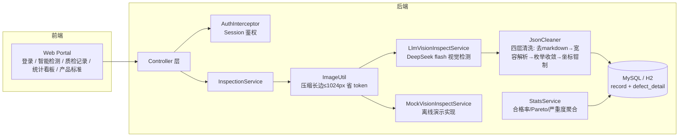

# AI 视觉质检助手（quality-vision）


面向**医疗器械产线**的视觉质检系统：上传产品照片 → 多模态大模型（VLM）自动识别缺陷类型并分级
→ 缺陷位置框选标注 → 质检记录全量入库 → 人工复核 → 质量看板统计。

**AI 初检 + 人工复核**双保险；支持 **真实 VLM / Mock 一键切换**，没 API Key 也能完整演示。

## 快速开始（3 分钟跑起来）

```bash
# 1. 最快体验：H2 内存库 + 自动建表 + 14 条演示数据，无需安装 MySQL
mvn spring-boot:run -Dspring-boot.run.profiles=demo

# 2. 浏览器打开
#    http://localhost:8080/login.html   账号 admin / 密码 123456
```

> 检测默认走真实 VLM（DeepSeek `deepseek-flash`）；未配置 Key 时自动降级为本地 Mock（结果打标 `MOCK`），全链路仍可演示。

## 技术栈

| 层 | 技术 |
|---|---|
| 后端 | Java 17 · Spring Boot 3.2.5 · MyBatis-Plus 3.5.7 · LangChain4j 1.0.0 |
| AI | DeepSeek `deepseek-flash` 多模态模型（OpenAI 兼容协议，换厂商只改 3 行配置） |
| 数据库 | MySQL 8（演示可用 H2 内存库替代） |
| 前端 | 原生 HTML/CSS/JS + ECharts（已本地化，离线可用）· 暗色工业风 |
| 测试 | JUnit 5 + H2 集成测试（10 个用例，CI 自动跑） |

## 架构



## 核心设计

| 模块 | 说明 |
|---|---|
| `VisionInspectService` | AI 检测接口，Mock / VLM 双实现，`vlm.mock-enabled` 开关切换，业务代码无感知 |
| `LlmVisionInspectService` | 真实 VLM：低温 0.2 + 封闭枚举 prompt + 0-1000 归一化坐标框；失败时 repair-loop 重试一次，最终降级 Mock（结果打标 `source`，入库可区分） |
| `JsonCleaner` | VLM 输出四层防线：去 markdown 包裹 → Jackson 宽容解析 → 枚举收敛/坐标钳制/缺失默认值 → 抛错由上层处理 |
| `InspectionService` | 上传→压缩（长边≤1024px 转 JPEG，省 token）→调 AI→落库（`AI_DONE` 待复核）→人工复核确认（幂等）；缺陷明细同事务写入 `defect_detail` |
| `StatsService` | 看板：每日合格率趋势、缺陷类型 Pareto、严重度分布、产品合格率对比、待复核数（Pareto 直接对明细表 GROUP BY） |
| 缺陷分类 | scratch 划痕 / crack 裂纹 / stain 污点 / deformation 变形 / missing_part 缺件 / hole 破洞 / earloop_defect 耳带缺陷 / seal_defect 封口缺陷；严重度 high/medium/low |

## 配置说明

### 1. 数据库（MySQL 模式）

```bash
# 建库建表 + 导入演示数据
mysql -u root -p < sql/schema.sql
mysql -u root -p < sql/mock_data.sql
```

`src/main/resources/application.yml` 中密码走环境变量，不硬编码：

```yaml
spring:
  datasource:
    username: root
    password: ${DB_PASSWORD:123456}   # 本地默认 123456，生产请设环境变量覆盖
```

### 2. 接真实 VLM（可选，不配也能跑）

1. 去 [DeepSeek 开放平台](https://platform.deepseek.com) 申请 API Key
2. 设置环境变量（推荐，Key 不进代码库）：
   ```bash
   # Windows
   setx VLM_API_KEY "sk-xxxx"
   # macOS / Linux
   export VLM_API_KEY="sk-xxxx"
   ```
   或直接改 `application.yml` 里的 `vlm.api-key`（注意不要提交到公开仓库）
3. `vlm.mock-enabled: false` 即真实检测；换厂商只改 `base-url` / `api-key` / `model` 三处，代码不动

> 未配 Key 时检测自动降级 Mock 并打标，接口永不抛错。

## 演示路线（3 分钟版）

1. **智能检测页**：选"一次性医用检查手套"，上传 `uploads/samples/glove_stain.jpg` → 点"开始 AI 检测" → 看缺陷框选 + 类型/严重度/置信度列表
2. **人工复核**：点"确认不合格"，填备注 → 记录状态变为"已复核"
3. **质检记录页**：按产品/批次/AI结论筛选，点"详情"看原图 + 标注框 + AI 原始 JSON（追溯证据链）
4. **统计看板页**：合格率趋势、缺陷 Pareto、严重度分布、产品对比
5. **产品与标准页**：每个产品的检测项 × 关注缺陷类型 × 严重度判定规则

完整演示脚本见 [DEMO.md](DEMO.md)。

## 接口一览

| 方法 | 路径 | 说明 |
|---|---|---|
| POST | /api/auth/login | 登录（body: username/password） |
| GET | /api/products | 产品下拉 |
| POST | /api/inspect | 上传检测（form: file/productId/batchNo） |
| GET | /api/records | 记录分页（productId/batchNo/overallResult/status） |
| GET | /api/records/{id} | 记录详情 |
| POST | /api/records/{id}/confirm | 人工复核（body: verdict=PASS/FAIL, note） |
| GET | /api/stats/dashboard?days=14 | 看板聚合 |
| GET/POST/DELETE | /api/standards | 质检标准管理 |

## 测试

```bash
mvn test   # H2 内存库，含 JsonCleaner 单测 + 检测/复核/登录/看板集成测试，CI 自动执行
```

## 诚实边界（技术权衡说明）

- VLM 返回的坐标框是**近似框**，只做前端展示级定位，不做像素级测量；生产级会换 YOLO 等专用检测模型，VLM 方案的优势是**零标注冷启动**。
- 低温 + 封闭枚举 + 服务端四层清洗，保证 JSON 可用性；`ai_raw_response` 原文存档，坏结果可追查。
- AI 检测是慢调用（3~15s），当前同步实现保证演示简单可靠；生产级改为 `@Async` + 轮询/SSE。

## 目录结构

```
quality-vision/
├── .github/workflows/       CI（mvn test 自动执行）
├── sql/                     建表 + 演示数据
├── uploads/samples/         演示用质检示例图
├── src/main/java/com/qualityvision/
│   ├── config/              VlmProperties / MyBatisPlus / 登录拦截器 / 静态资源映射
│   ├── controller/          auth / inspect / records / stats / standards
│   ├── service/             VisionInspectService(Mock+VLM双实现) / InspectionService / StatsService / AuthService
│   ├── domain/ mapper/ dto/ util/    实体 / Mapper / 缺陷DTO / ImageUtil+JsonCleaner
│   └── resources/static/    登录页 + 暗色工业风 Portal（检测/记录/看板/标准）
└── src/test/                H2 集成测试
```

## License

[MIT](LICENSE)
